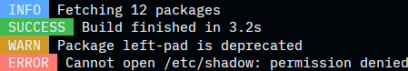

# tColorLog

A small Go library for display better logs.

## Compatibility
- 1.26.8

## Installation
```
go get github.com/tPortal-Dev/tColorLog
```

## Usage
```go
import (
	tcl "github.com/tPortal-Dev/tColorLog"
)

func main() {
	tcl.PrintInfo("Fetching %d packages", 12)
	tcl.PrintSuccess("Build finished in %.1fs", 3.2)
	tcl.PrintWarn("Package %s is deprecated", "left-pad")
	tcl.PrintError("Cannot open %s: permission denied", "/etc/shadow")
}
````

### Output


## License
[MIT](LICENSE)